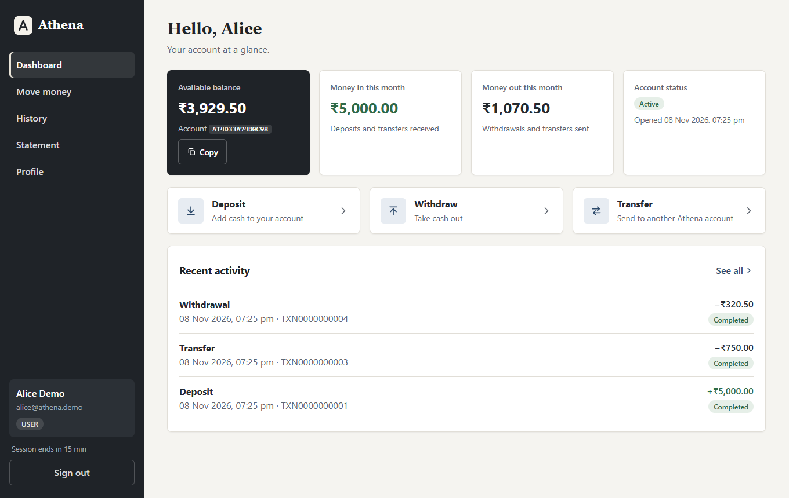

# Athena

**A financial transaction simulator: every transaction accurate, every
movement authorized, every record traceable.**

Customers deposit, withdraw and transfer money through a React app. Every
movement is posted to a **double-entry ledger** in PostgreSQL, protected
against duplicate requests, race conditions and tampering, and written to an
**audit log** that auditors and administrators can inspect.

> **BalanceVault submission.** The LedgerLine challenge was renamed
> BalanceVault; Athena is this project's name for its BalanceVault entry
> (it was built as LedgerLine and renamed). It keeps every original
> requirement and adds the new ones: account management and staff
> onboarding, role-based access, Redis rate limiting, a first-admin
> bootstrap script, least-privilege database roles and health checks. Where
> each requirement is met, and how it is proven:
> [important/BALANCEVAULT.md](important/BALANCEVAULT.md). The technical
> write-up: [important/TECHNICAL_WRITEUP.md](important/TECHNICAL_WRITEUP.md).

> **Live demo:** _add your Vercel URL here_ · Demo accounts: [important/DEMO.md](important/DEMO.md) ·
> Presentation: [important/Athena-Technology-Overview.pptx](important/Athena-Technology-Overview.pptx)



## Features

| Area | What you get |
| --- | --- |
| Accounts | Registration with BCrypt passwords; an account number per customer; sign-in with short-lived JWTs, server-side logout and automatic sign-out on expiry; a Profile page to change the password, which ends every session |
| Onboarding | Customers sign up themselves. The first administrator comes from `scripts/bootstrap-admin` (only while there is none); administrators then add other administrators and auditors in the app |
| Money | Deposits, withdrawals and transfers (with confirmation), exact decimals end to end |
| Ledger | Double-entry postings against a settlement (cash) account; the database refuses to commit an unbalanced transaction, and refuses to change or delete any ledger, transaction or audit row once written |
| Safety | Idempotency keys (a retry never pays twice), row locking in a fixed order (no double spending, no deadlocks), atomic rollback |
| History | Search by reference or account; filters by type, status and date; paging, sorting and transaction details with ledger entries |
| Statements | Opening and closing balances, money in and out, running balance, CSV download, print |
| Roles | USER (own money), AUDITOR (read-only monitoring), ADMIN (users, staff and account freezing, no money movement), each checked twice on the server |
| Oversight | Every transaction, the audit log, system totals and a live ledger reconciliation |
| Security | Login throttling and rate limits shared by every instance through Redis, request size limits, strict CSP and security headers, closed CORS, problem-JSON errors without internals |
| Database | The app connects as a restricted role (`athena_app`) that cannot rewrite history, empty tables or change the schema; the owner only creates the tables |
| Operations | A health check per dependency (`{"status","database","redis"}`), Docker Compose with PostgreSQL and Redis, a Render blueprint, CI that starts the whole stack |

## Works on every screen and browser

| Where | How it looks and works |
| --- | --- |
| Phones | A top bar with a Menu button, tables shown as cards, confirmations that slide up from the bottom, 16 px text in forms (no zoom on focus), every button at least 44 px tall |
| Tablets | The same top bar; tables as two-column cards |
| Desktops | A sidebar and full tables |
| Browsers | Chrome, Edge, Firefox, Safari (Mac, iPhone, iPad) and Samsung Internet from the last few years: Chrome, Edge and Firefox 100+, Safari and iOS 15+. Form controls are restyled, so they look and size the same in each. |
| Look | Calm ink, paper and slate-blue colours with muted status colours; every text colour meets WCAG AA contrast |
| Tested | Every browser test runs in six setups on each push: desktop, tablet and phone in Chromium, then Firefox, Safari (WebKit) and an iPhone screen |

On a phone: [dashboard](important/screenshots/10-phone-dashboard.png) ·
[menu](important/screenshots/11-phone-menu.png) ·
[history as cards](important/screenshots/12-phone-history.png).

## Tech stack

Java 21 · Spring Boot 4.1 · Spring Security 7 · JJWT · Hibernate 7 ·
PostgreSQL · Redis (Jedis 7) · React 19 · React Router 7 · Axios · Vite 8 ·
JUnit 6 · Vitest · Playwright · Docker · GitHub Actions

The FAQ's "PostgreSQL / Prisma": Prisma is a Node.js ORM, and this backend is
Java, so Hibernate (JPA) plays its part, with entities checked against the
real schema at every start (`ddl-auto=validate`).

## Documentation

Everything to read, present, test and deploy is in one folder,
**[important/](important/README.md)**, which opens with a start-here index.

| Read this | To learn |
| --- | --- |
| [important/BALANCEVAULT.md](important/BALANCEVAULT.md) | Every BalanceVault requirement: where it is met and which test proves it |
| [important/TECHNICAL_WRITEUP.md](important/TECHNICAL_WRITEUP.md) | The technical write-up: design, the hard problems and how they were solved, trade-offs |
| [important/ARCHITECTURE.md](important/ARCHITECTURE.md) | System and request-flow diagrams, the double-entry model, the ER diagram |
| [important/API.md](important/API.md) | Every endpoint and error code |
| [THREATS.md](THREATS.md) | The threat model: 41 threats, their defences, and the tests that prove them |
| [PROMPTS.md](PROMPTS.md) | How AI was used, and every time it was wrong |
| [important/testing/](important/testing/TESTING.md) | All testing in one place: every test file, how to run them, the Postman collection, the security check and the latest results |
| [important/STEP_1_VERCEL_PREREQUISITES.md](important/STEP_1_VERCEL_PREREQUISITES.md) | Going live, step 1: the software, accounts, passing tests, secrets and names to have ready |
| [important/STEP_2_PUSH_TO_GITHUB.md](important/STEP_2_PUSH_TO_GITHUB.md) | Step 2: put all the files on GitHub without secrets, and protect the repository |
| [important/STEP_3_GITHUB_TO_VERCEL_AND_SECURITY.md](important/STEP_3_GITHUB_TO_VERCEL_AND_SECURITY.md) | Step 3: connect GitHub to Vercel (website) and Render (API and database), go live and handle security |
| [important/PRODUCTION_READINESS.md](important/PRODUCTION_READINESS.md) | The 19-item go-live checklist (security, configuration, resilience, quality, performance), item by item with proof |
| [important/DEPLOYMENT.md](important/DEPLOYMENT.md) | Render, Docker and plain Java deployment |
| [important/Athena-Technology-Overview.pptx](important/Athena-Technology-Overview.pptx) | A 16-slide deck: each technology and its job, with speaker notes |
| [important/DEMO.md](important/DEMO.md) | Demo accounts, a 7-minute demo script, the demo video shot list, test scenarios, screenshots |
| [important/GLOSSARY.md](important/GLOSSARY.md) | Every technical term used in the project, explained |
| [important/judging/](important/judging/README.md) | One guide per judging criterion |

## Quick start (Windows CMD)

Prerequisites: JDK 21+, Node.js 22+, PostgreSQL 16+.

**Once:** save your database password and a new JWT key, create the
databases and install the website packages:

```bat
cd /d E:\athena
scripts\setup-local.cmd
```

It asks for your PostgreSQL password (hidden while you type) and whether to
create the demo users, then writes everything to `.env`, which git ignores:
your `postgres` password as the tables' owner, a random password for the
app's own restricted role `athena_app` (the app creates it at startup), and a
JWT key. The backend reads `.env` when it starts, so nothing has to be typed
again. An `.env` from before the restricted role is upgraded in place, after
asking.

**Once, optional:** create your own first administrator (the demo users
include one already):

```bat
scripts\bootstrap-admin.cmd
```

**Every time:** start the API (http://localhost:8080) and the website, each
in its own window, then open http://localhost:5173:

```bat
cd /d E:\athena
scripts\start-local.cmd
```

Or start them yourself: `mvnw spring-boot:run` in `backend\athena` and
`npm run dev` in `frontend`. Close a window to stop that part.

**Tests:** `mvnw test` in `backend\athena` (it uses the `athena_test`
database the setup created) and `npm test` in `frontend`.

To change a setting later, run `notepad .env`; every setting is described
below. A real environment variable still wins over `.env`. For Docker, see
[important/DEPLOYMENT.md](important/DEPLOYMENT.md).

## Environment variables

| Variable | Required | Default | Purpose |
| --- | --- | --- | --- |
| `DB_USERNAME` / `DB_PASSWORD` | yes | `postgres` / – | The role the app connects as: `athena_app` and a long random password, created by the app at startup when the owner below is set |
| `DB_OWNER_USERNAME` / `DB_OWNER_PASSWORD` | yes, for least privilege | `DB_USERNAME` / `DB_PASSWORD` | The tables' owner, used at startup only (schema and the app's role); must be allowed to create roles. Unset: one user does everything, with no restricted role |
| `JWT_SECRET` | yes | – | Base64 of 32+ random bytes. The app refuses to start without a strong one. |
| `REDIS_URL` | in production | unset | `redis://` or `rediss://` URL; rate limits and sign-in counters are then shared by every instance. Unset: per-instance memory, with a warning in the log |
| `REDIS_TIMEOUT_MS` | no | `1000` | Redis connect and read timeout |
| `BOOTSTRAP_ADMIN_EMAIL` / `BOOTSTRAP_ADMIN_PASSWORD` / `BOOTSTRAP_ADMIN_NAME` | no | unset / unset / `Athena Administrator` | Creates the first administrator at startup, only while none exists (password 12+ characters with a letter and a digit). Remove after the first start; `scripts/bootstrap-admin` asks for them instead |
| `BOOTSTRAP_ONLY` | no | `false` | Prepare the database (and create the administrator, if asked), then exit |
| `DB_URL` | no | `jdbc:postgresql://${DB_HOST}:${DB_PORT}/${DB_NAME}` | Full JDBC URL (overrides the three below) |
| `DB_HOST` / `DB_PORT` / `DB_NAME` | no | `localhost` / `5432` / `athena` | Database location |
| `PORT` | no | `8080` | HTTP port |
| `JWT_EXPIRATION_MS` | no | `900000` (15 min) | Access token lifetime |
| `FORWARD_HEADERS_STRATEGY` | no | `none` | `native` behind a TLS proxy (set in the Docker image) |
| `CORS_ALLOWED_ORIGINS` | no | empty (closed) | Comma-separated website addresses allowed to call the API, e.g. the Vercel address (see important/STEP_3_GITHUB_TO_VERCEL_AND_SECURITY.md) |
| `API_RATE_LIMIT_PER_MINUTE` | no | `600` | API requests per client IP per minute |
| `REGISTRATION_LIMIT_PER_HOUR` | no | `50` | Registrations per client IP per hour |
| `LOGIN_MAX_FAILURES_PER_ACCOUNT_AND_IP` | no | `5` | Failed logins before a 15-minute pause |
| `LOGIN_MAX_FAILURES_PER_IP` / `_PER_ACCOUNT` | no | `30` / `50` | Wider login limits |
| `LOGIN_LOCKOUT_MINUTES` | no | `15` | How long a sign-in pause lasts |
| `MAX_REQUEST_BYTES` | no | `16384` | Largest accepted request body |
| `DEMO_DATA_ENABLED` | no | `false` | Create the demo users |
| `DEMO_ADMIN_PASSWORD` / `DEMO_AUDITOR_PASSWORD` / `DEMO_USER_PASSWORD` | if demo | – | 12+ characters with a letter and a digit |
| `SHOW_SQL` | no | `false` | Log SQL statements (development only) |
| `TEST_DB_URL` | tests | `jdbc:postgresql://localhost:5432/athena_test` | Test database (its name must end in `_test`) |
| `VITE_API_BASE_URL` | frontend build, if the API is elsewhere | unset (same origin) | The API address built into the website, e.g. `https://athena.onrender.com` (set in Vercel) |

Never commit real values: `.env` is git-ignored, and
[.env.example](.env.example) lists the names.

## Project layout

```
athena/
├─ backend/athena/            Spring Boot API
│  ├─ src/main/java           the code (controller, service, repository, entity, security, ...)
│  ├─ src/main/resources/db   schema.sql (tables, constraints, ledger and append-only triggers, grants), seed.sql
│  └─ src/test                235 backend tests
├─ frontend/                  React website
│  ├─ src                     pages, components, API client (unit tests sit next to the code)
│  ├─ e2e                     Playwright browser tests
│  └─ vercel.json             settings for hosting the website on Vercel
├─ important/                 start here: deck, go-live steps 1 to 3, architecture, API, glossary, demo, judging
│  └─ testing/                Postman collection, security check, test guide and results
├─ scripts/                   setup-local.cmd (once: .env, databases), start-local.cmd (API + website),
│                             bootstrap-admin.cmd / .sh (the first administrator)
├─ .github/                   CI, CodeQL, Dependabot
├─ Dockerfile, docker-compose.yml, render.yaml, .env.example
└─ README.md, THREATS.md, PROMPTS.md
```

## Test results (2026-11-10)

Backend **235/235** · Frontend unit **74/74** · Postman **88/88** ·
Browser tests **50/50** in six setups (desktop, tablet and phone; Chrome/Edge,
Firefox, Safari) · Security check **21/21** (**23/23** with the website on a
separate origin, as on Vercel, where all 48 browser tests also passed), with
the ledger consistent afterwards. All of it ran as in production: limits
counted in Redis, and the app connected as its restricted database role.
Details: [important/testing/TEST_RESULTS.md](important/testing/TEST_RESULTS.md).
