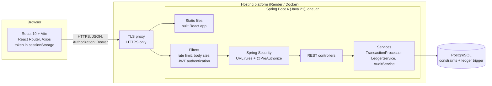
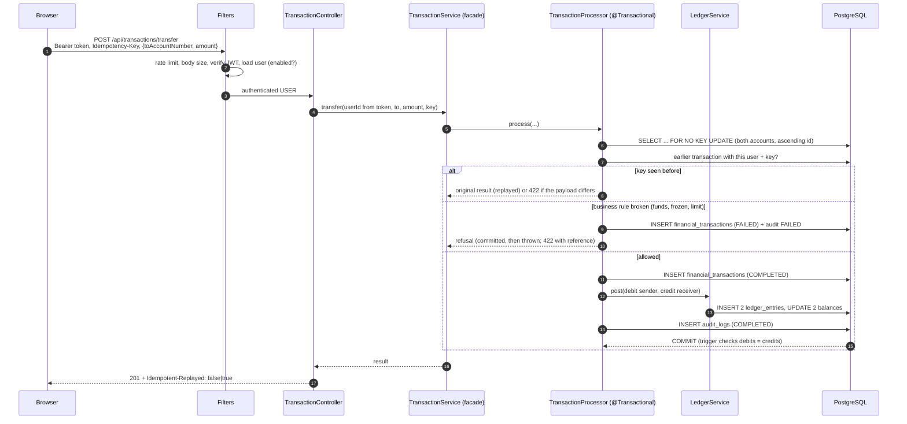
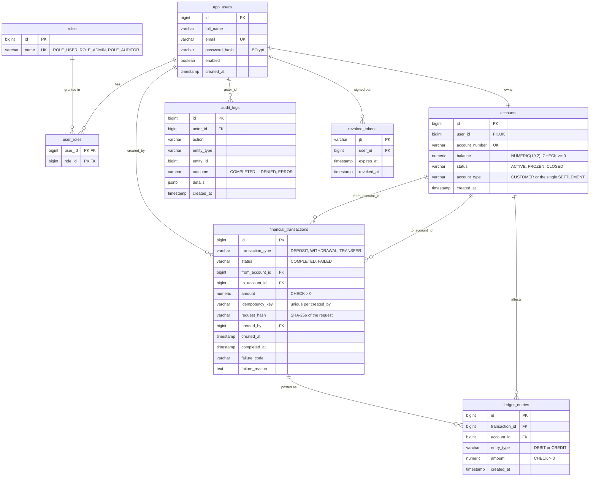

# Architecture

## 1. System overview

* **One origin.** The React app is built into the jar and served by Spring
  Boot, so the browser needs no CORS, and every page gets the backend's
  security headers (CSP, frame blocking).
* **Stateless API.** No server sessions. Each request carries a short-lived
  JWT. The server loads the user and roles from the database on every
  request, and checks the token id against the logout list.
* **The database guards money too.** Constraints (`balance >= 0`,
  `amount > 0`, valid account pairs) and a deferred trigger (debits = credits)
  hold even if the application has a bug.

## 2. Backend layers

| Layer | Package | Responsibility |
| --- | --- | --- |
| Filters | `security` | `RateLimitFilter`, `RequestSizeLimitFilter`, `JwtAuthenticationFilter`, problem-JSON 401/403 |
| Configuration | `security`, `config` | `SecurityConfig` (rules, headers, CORS), `SpaWebConfig`, `DemoDataInitializer`, `TimeConfig` |
| Controllers | `controller` | HTTP only: validate input, take the user from the token, call one service method |
| Services | `service` | Business rules and transactions |
| Repositories | `repository` | Spring Data JPA queries (bound parameters only) |
| Entities | `entity` | JPA mappings of the tables; `LedgerEntry`, `AuditLog`, `RevokedToken` are immutable |
| DTOs | `dto` | Request and response shapes; never expose entities or password hashes |
| Errors | `exception` | `BusinessException` subclasses carry an HTTP status and a stable `code`; `GlobalExceptionHandler` writes RFC 9457 problem details |

### Money request flow (transfer)

If anything throws inside the processor, the whole database transaction
rolls back: no balance, ledger entry or transaction row is left behind. The
facade then writes a REJECTED or ERROR audit record in a new transaction, so
even failed requests are recorded.

## 3. Double-entry model

The bank's view: customer accounts are liabilities (credit-normal), and the
single `AT-SETTLEMENT` account is the bank's cash (debit-normal).

| Operation | Debit | Credit | Effect |
| --- | --- | --- | --- |
| Deposit 100 | AT-SETTLEMENT | customer | cash +100, customer +100 |
| Withdrawal 40 | customer | AT-SETTLEMENT | customer −40, cash −40 |
| Transfer 25 | sender | receiver | sender −25, receiver +25 |

So at every moment: **settlement balance = sum of all customer balances**,
and **total debits = total credits**. `/api/oversight/integrity` checks both,
plus every balance against its own entries.

## 4. Database (ER diagram)

Database rules that protect money (see `backend/athena/src/main/resources/db/schema.sql`):

* `chk_account_balance`: no negative balance, ever.
* `chk_transaction_accounts`: a deposit has only a receiver, a withdrawal
  only a sender, a transfer two different accounts.
* `uq_accounts_single_settlement`: exactly one settlement account.
* `uq_transactions_user_idempotency_key`: one transaction per user and key.
* `trg_ledger_entries_balanced`: a deferred constraint trigger that refuses
  to commit a transaction whose debits and credits differ.

## 5. Frontend structure

| Folder | Contents |
| --- | --- |
| `src/api` | `client.js` (Axios: token header, 401 handling, exact decimal parsing, error normalization); `athena.js` (one function per endpoint) |
| `src/auth` | `AuthContext` (sign-in, sign-out, expiry timer, roles), `RequireAuth` (protected routes), `session.js` (sessionStorage) |
| `src/pages` | Sign-in and registration, dashboard, move money, history with details, statement, overview, monitoring, audit log, users |
| `src/components` | Layout and navigation by role, dialogs, badges, alerts, pagination |
| `src/lib` | Exact money formatting and parsing, idempotency keys, CSV export, validation |
| `e2e` | Playwright browser tests |

Money is never a JavaScript float in the frontend. Amounts typed by the user
are checked as text and sent exactly as typed. Amounts from the server are
parsed as exact text (`parseJsonExact`) and formatted with `BigInt`.
