# Demo guide

## Demo accounts

Start the backend with `DEMO_DATA_ENABLED=true` (see DEPLOYMENT.md). Four
users are created, with passwords taken from environment variables. No
password is stored in the repository.

| Email | Role | Password from | Starts with |
| --- | --- | --- | --- |
| `admin@athena.demo` | ADMIN | `DEMO_ADMIN_PASSWORD` | No account; user management and monitoring |
| `auditor@athena.demo` | AUDITOR | `DEMO_AUDITOR_PASSWORD` | No account; read-only monitoring and audit log |
| `alice@athena.demo` | USER | `DEMO_USER_PASSWORD` | ₹3,929.50 (deposit 5,000, transfer 750 to Bob, withdrawal 320.50) |
| `bob@athena.demo` | USER | `DEMO_USER_PASSWORD` | ₹1,950.00 (deposit 1,200, received 750) |

You can also register new customers on the sign-up page, and create your
own first administrator with `scripts\bootstrap-admin.cmd` (it does nothing
once an administrator exists, so with the demo users on, run it on a fresh
database).

## A 7-minute demo script

1. **Sign in as Alice.** The dashboard shows the balance, money in and out
   this month, and recent activity.
2. **Move money → Transfer** ₹125 to Bob's account number. A confirmation
   shows the balance after the transfer; confirm it. The success message
   gives the reference (TXN…).
3. **Try to break it.** Withdraw more than the balance: the page refuses
   before sending. To show the server refusing too, use the Postman request
   "Withdraw more than the balance": you get 422 `INSUFFICIENT_FUNDS` with a
   reference, and the attempt appears in History as *Failed*.
4. **History.** Filter by Transfer, then open a row: the details show both
   ledger entries (debit Alice, credit Bob) of the same amount.
5. **Statement.** Opening balance + money in − money out = closing balance.
   Download the CSV or print it.
6. **Idempotency.** In Postman, folder "3 - Idempotency", send the same
   deposit twice with one key. The second answer is the same transaction,
   with `Idempotent-Replayed: true`, and the balance is unchanged. Then
   change the amount with the same key: 422 `IDEMPOTENCY_KEY_REUSED`.
7. **Sign in as the auditor** (another browser window). The overview shows
   "The books balance", with 7 green checks. The Audit log shows every
   action above, including the refused attempt.
8. **Sign in as the admin → Users.** Freeze Bob's account with a reason.
   Bob's dashboard now says the account is frozen, and money moves fail.
   Unfreeze it. The audit log shows both changes with the admin's email.
9. **Add a staff member.** Still as the admin: **Add staff member**, role
   Auditor, **Generate password**, Add. Sign in as the new auditor in a
   private window with that password, open **Profile** and change it: the
   page signs out at once and asks for the new password. The audit log shows
   `STAFF_CREATED` and `PASSWORD_CHANGED`.
10. **Security in one command:**
    `node important/testing/security-check.mjs <url>`. 21 attacks, all refused, and
    the ledger is still consistent at the end.

## Test scenarios

| # | Scenario | Expected result |
| --- | --- | --- |
| 1 | Register with an existing email (any case) | 409 `EMAIL_ALREADY_REGISTERED` |
| 2 | Sign in with a wrong password 5 times | 401 each time, then 429 `LOGIN_THROTTLED` for 15 minutes from that network |
| 3 | Deposit 0, -5 or 10.001 | 400, nothing saved |
| 4 | Withdraw more than the balance | 422 `INSUFFICIENT_FUNDS`, saved as FAILED, balance unchanged |
| 5 | Transfer to yourself / to `AT-SETTLEMENT` / to an unknown account | 400 / 404 / 404 |
| 6 | Same deposit twice with one `Idempotency-Key` | One transaction; the second answer is marked replayed |
| 7 | Ten simultaneous withdrawals of the whole balance | Exactly one succeeds; the balance ends at 0.00 |
| 8 | A customer opens `/admin/users` | The page shows "No access"; the API answers 403 and audits it |
| 9 | Sign out, then reuse the old token | 401 `TOKEN_REVOKED` |
| 10 | Wait 15 minutes without signing out | The app signs out by itself and explains why |
| 11 | Admin freezes an account | The owner cannot deposit, withdraw, send or receive |
| 12 | Edit a balance directly in the database | The auditor's integrity check turns red and names the account |
| 13 | `UPDATE ledger_entries …` or `DELETE FROM audit_logs` in psql, even as the owner | `ERROR: … is append-only`; nothing changes |
| 14 | The same as the app's role `athena_app` | `ERROR: permission denied` (SQLSTATE 42501) |
| 15 | Change the password, then reuse a token from before | 401 `TOKEN_REVOKED`, on every device |
| 16 | Run `scripts\bootstrap-admin.cmd` when an administrator exists | Nothing changes; no password is reset |
| 17 | Stop Redis while the app runs | Limits keep working; `/api/health` shows `"redis":"DOWN"` until it is back |

## Screenshots

| | |
| --- | --- |
| 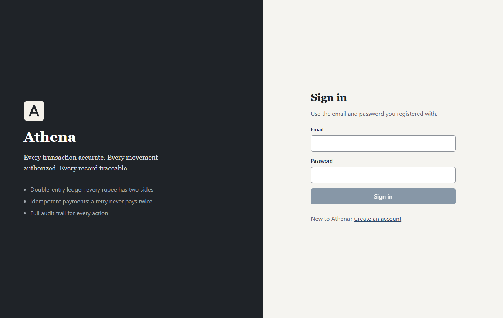 | 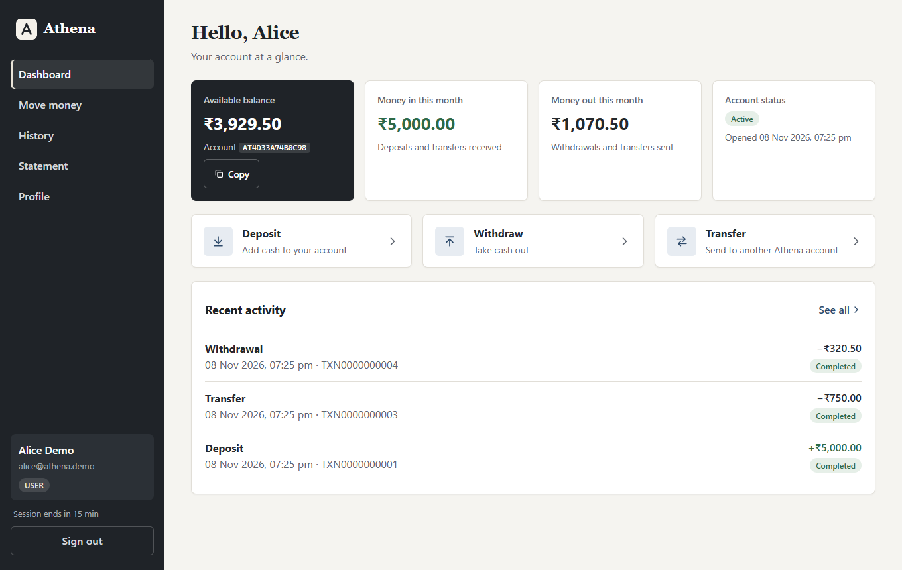 |
| 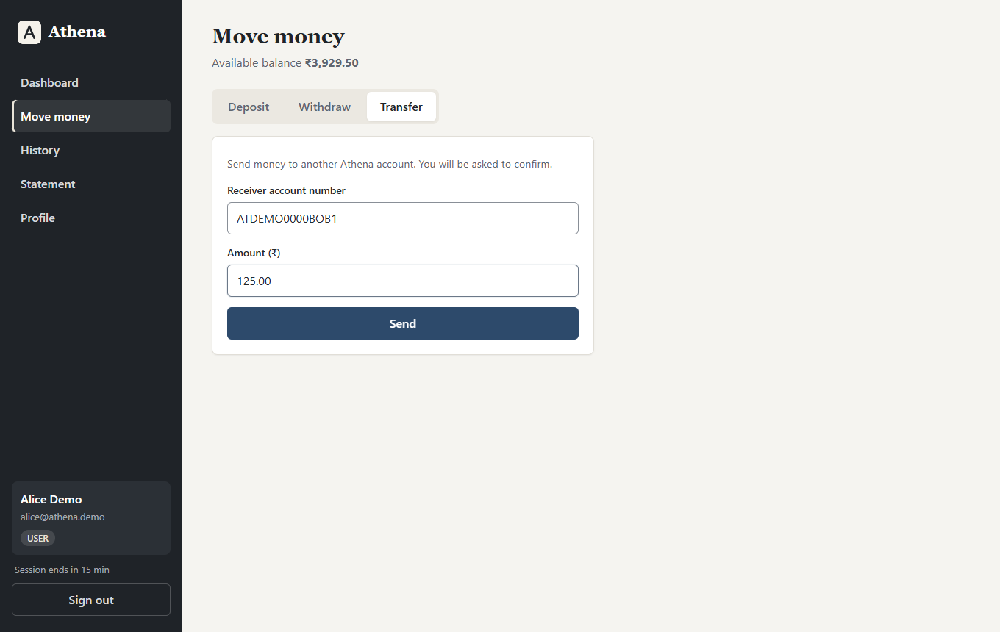 | 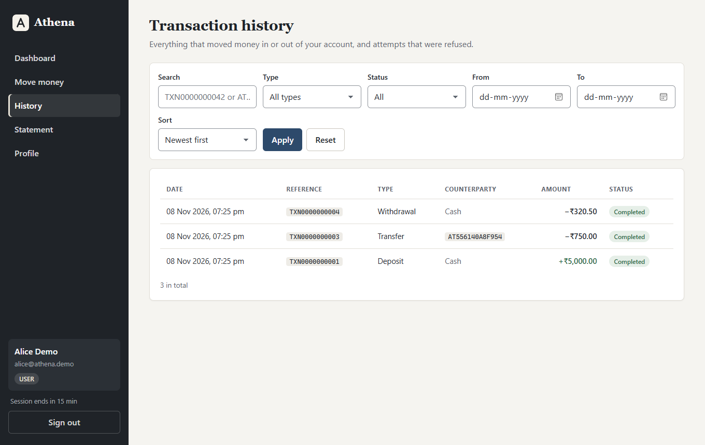 |
| 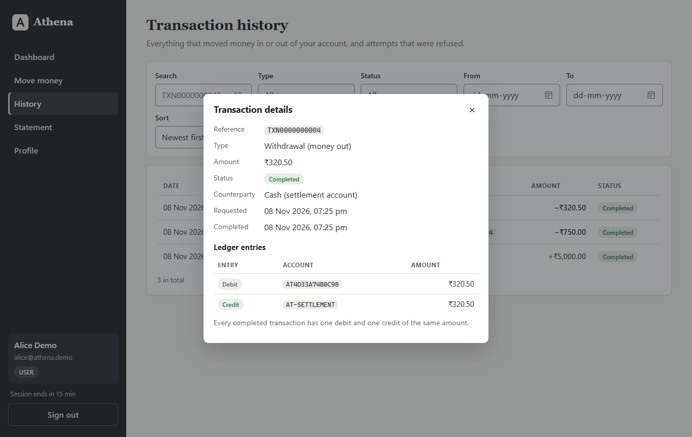 | 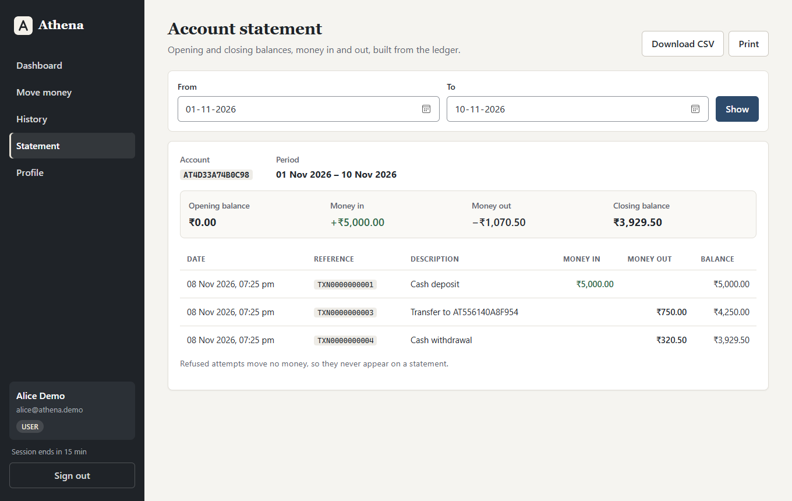 |
| 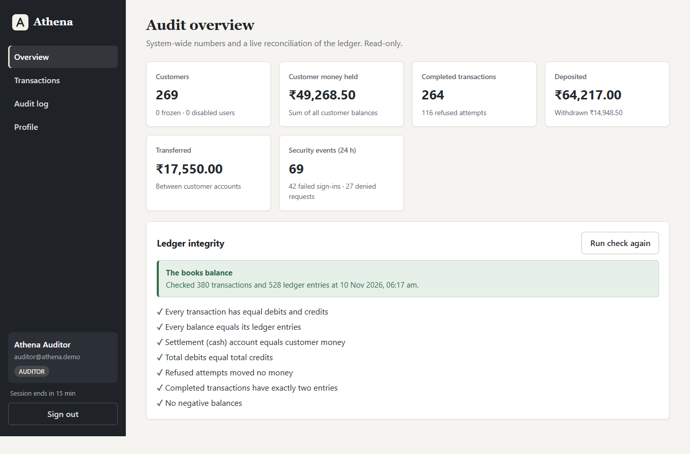 | 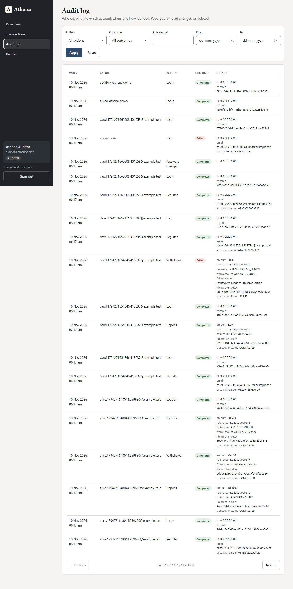 |
| 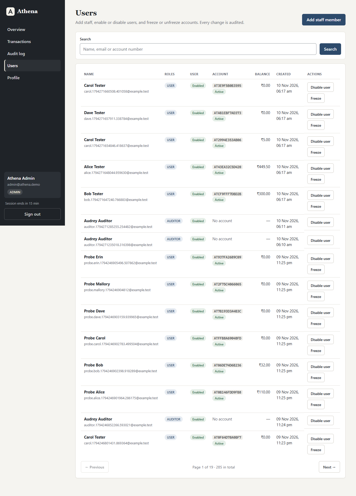 | 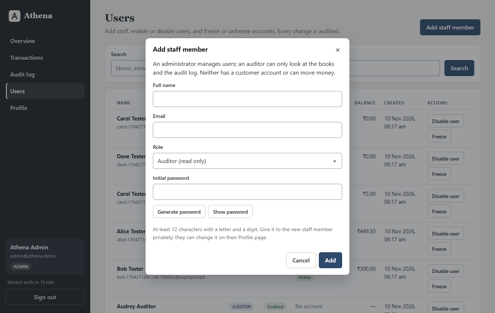 |
| 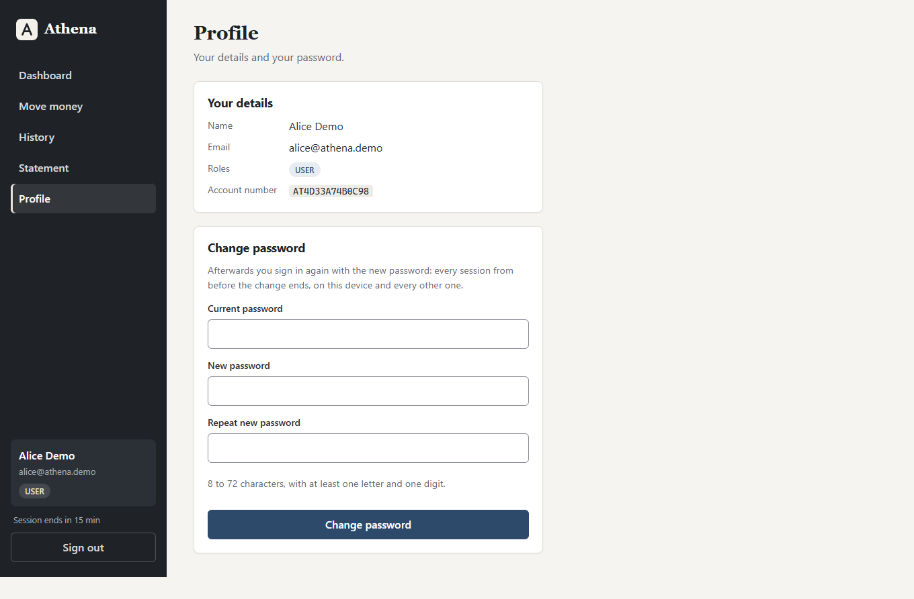 | |

## Demo video

A shot list for a recording of about 8 minutes. Record at 1920×1080 with the
browser at 100 % zoom; use the demo users on a fresh database, or the live
deployment. Never show a real password or a `.env` file on screen: type
passwords into password fields only, and keep the terminal clear of secrets.

| # | Time | On screen | Say |
| --- | --- | --- | --- |
| 1 | 0:00 | The README's first screen, then the BalanceVault box | "Athena is our BalanceVault entry: a transaction simulator where every movement is double-entry, idempotent, safe under concurrency and audited." |
| 2 | 0:30 | Sign in as Alice; the dashboard | "Customers see their balance and this month's money in and out." |
| 3 | 0:50 | Move money → Transfer ₹125 to Bob; the confirmation; the reference | "Every transfer is confirmed first and gets a reference." |
| 4 | 1:20 | History → the transfer → its two ledger entries | "Each movement is two equal ledger lines: a debit and a credit." |
| 5 | 1:50 | Postman, folder 3: the same deposit twice; `Idempotent-Replayed: true`; then 422 with a changed amount | "A retry never pays twice, and a key cannot be reused for another payment." |
| 6 | 2:30 | A terminal: `mvnw test -Dtest=TransactionServiceIntegrationTest` passing; then the concurrent-withdrawals test in the code | "Ten withdrawals of the whole balance at the same instant: exactly one succeeds." |
| 7 | 3:10 | Withdraw more than the balance in Postman: 422 with a reference; History shows it as Failed | "Overdrafts are refused on the locked row, and the refusal is kept." |
| 8 | 3:40 | psql: `DELETE FROM audit_logs;` → `audit_logs is append-only`; as `athena_app` → `permission denied` | "History cannot be rewritten: the database refuses it, and the app's own login has no right to try." |
| 9 | 4:20 | Sign in as the auditor: "The books balance", 7 green checks; the audit log | "Auditors see everything and change nothing." |
| 10 | 4:50 | As the admin: freeze Bob; Bob's dashboard says frozen; unfreeze | "Administrators manage users and accounts, never money." |
| 11 | 5:20 | As the admin: Add staff member → Auditor → Generate password → Add | "After the first administrator, staff join through the app, audited." |
| 12 | 5:50 | `scripts\bootstrap-admin.cmd` output from a fresh database (pre-recorded is fine); then run again: nothing changed | "The first administrator comes from a bootstrap script that works only once." |
| 13 | 6:20 | The new auditor's Profile → change password → signed out with a note; the old session in another window gets "signed out" | "Changing a password ends every session at once." |
| 14 | 6:50 | `curl /api/health` → `{"status":"UP","database":"UP","redis":"UP"}`; the Render dashboard with the database and Key Value | "Rate limits are shared through Redis; the health check reports each dependency." |
| 15 | 7:20 | `node important/testing/security-check.mjs <url>`: 21 passed | "Twenty-one attacks, all refused, and the ledger still balances." |
| 16 | 7:45 | GitHub Actions: a green run, with the Compose and end-to-end jobs | "Every push runs all of this, in three browsers and on three screen sizes." |
