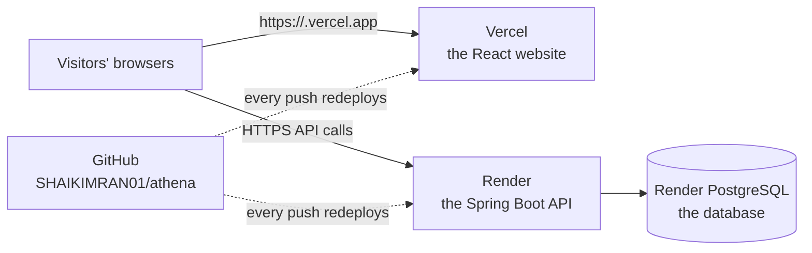

# Step 1 of 3: what you need before Athena goes on Vercel

Read this first, tick every box, then go to
[STEP_2_PUSH_TO_GITHUB.md](STEP_2_PUSH_TO_GITHUB.md).

## How Athena will run online



* **Vercel** hosts the website (the `frontend/` folder).
* **Render** hosts the API and the database. Vercel cannot run a Java
  server; [Step 3](STEP_3_GITHUB_TO_VERCEL_AND_SECURITY.md) explains why.
* **GitHub** holds the code. Vercel and Render both deploy from it.

## 1. Software on your computer

Check each one in CMD:

| Need | Why | Check with | You have |
| --- | --- | --- | --- |
| Git 2.40 or newer, with Git Credential Manager | Upload the code to GitHub | `git --version` | 2.52, with the manager |
| Java (JDK) 21 or newer | Build and test the API | `java -version` | 22 |
| Node.js 22.12 or newer, with npm | Build and test the website | `node --version` | 24.4 |
| PostgreSQL 16 or newer | Run the backend tests on your computer | `"C:\Program Files\PostgreSQL\18\bin\psql.exe" --version` | 18 |
| Microsoft Edge | The browser tests use it | (installed with Windows) | yes |

- [ ] All five are installed.

## 2. Accounts

| Account | Used for | Plan to start with |
| --- | --- | --- |
| [GitHub](https://github.com) | Holds the code (`SHAIKIMRAN01/athena`) | Free |
| [Vercel](https://vercel.com) | Hosts the website | Hobby (free, for personal, non-commercial projects) |
| [Render](https://render.com) | Hosts the API and the database | Free to try. See the limits below. |

- [ ] Sign up to Vercel and Render **with your GitHub account** ("Continue
  with GitHub"). Then one strong sign-in protects all three.
- [ ] Turn on **two-factor authentication** on GitHub, Vercel and Render.
  An attacker with your password could otherwise change the live site.

**Limits of the free plans you must know:**
* Render's free web service **sleeps after 15 minutes** without visitors.
  The next request waits about 30 to 60 seconds while it wakes up.
* Render's free PostgreSQL database is **temporary**. It expires after a fixed
  period (30 days at the time of writing; check Render's pricing page). After a
  14-day grace period it is **deleted with all its data** unless you upgrade.
* For judging, an always-on paid instance and a paid database avoid both
  problems. Otherwise, open the API's `/api/health` address a couple of
  minutes before you start, and deploy close to the judging date.

## 3. The project works on your computer

Run these in CMD. Each has an expected result.

**Backend tests** (needs the `athena_test` database, see
[testing/TESTING.md](testing/TESTING.md)). If you ran `scripts\setup-local.cmd`
once, leave out the `set DB_PASSWORD` line: the password comes from `.env`.
```bat
cd /d E:\athena\backend\athena
set DB_PASSWORD=your-postgres-password
mvnw clean test
```
- [ ] `Tests run: 235, Failures: 0, Errors: 0` and `BUILD SUCCESS`. No Redis is
      needed for the tests: they start their own in-test Redis.

**Website lint, tests and build:**
```bat
cd /d E:\athena\frontend
npm ci
npm run lint
npm run format:check
npm test
npm run build
```
- [ ] No lint warnings, `All matched files use Prettier code style!`, `Tests 74 passed`, and the build ends with `built in`.

**The build Vercel will make** (the API on another address):
```bat
set VITE_API_BASE_URL=https://example-api.onrender.com
npm run build
findstr /C:"example-api.onrender.com" dist\index.html
set VITE_API_BASE_URL=
```
- [ ] `findstr` prints a `Content-Security-Policy` line that names the API.

**Optional, recommended:** run the whole app with the browser tests and the
security check, as in [testing/TESTING.md](testing/TESTING.md), section 3.
- [ ] Playwright passes; the security check says `21 passed, 0 failed`.

## 4. The deployment files are in the project

- [ ] `frontend/vercel.json`: tells Vercel how to build the website, how to handle page routes, and which security headers to send.
- [ ] `frontend/.env.example`: names the one website setting (`VITE_API_BASE_URL`).
- [ ] `render.yaml`: tells Render to create the API and the database.
- [ ] `Dockerfile` and `.dockerignore`: how Render builds the API.
- [ ] `.env.example`: names the API settings, with no values.
- [ ] `.github/workflows/ci.yml`: the automatic tests on GitHub.

## 5. Decisions to make now

| Decision | Options | Recommendation |
| --- | --- | --- |
| Repository visibility | Public or private | **Public** if judges must read the code. Vercel and Render work with both. On a private repository, CodeQL needs GitHub Advanced Security; delete `.github/workflows/codeql.yml` if you don't have it. |
| Render service name | `athena` (in `render.yaml`) or your own | Keep `athena`. The address becomes `https://athena.onrender.com`, with a suffix if the name is taken. |
| Vercel project name | Your choice | `athena`, which gives `https://athena.vercel.app` (with a suffix if taken). |
| Sleeping and expiry | Free plans, or paid always-on | Paid for judging day; free is fine for practice. |
| Own domain | Optional | Can be added later (Step 3, section 3G). |

- [ ] Decisions made and the two names written down.

## 6. Secrets, prepared but never in git

**JWT signing key.** Run this in CMD and save the output in a password
manager:
```bat
powershell -NoProfile -Command "$b=New-Object byte[] 48; [Security.Cryptography.RandomNumberGenerator]::Create().GetBytes($b); [Convert]::ToBase64String($b)"
```
- [ ] Saved. It goes **only** into Render's dashboard.

**Demo passwords** for `admin@`, `auditor@`, and `alice@` and `bob@athena.demo`.
Use 12 or more characters, with a letter and a digit.
- [ ] Three passwords saved. You will give them to the judges privately,
  never in the README or the repository.

> **Never put a secret in a `VITE_` variable.** Everything named `VITE_…`
> is built into the website's JavaScript, which anyone can read. The website
> needs only `VITE_API_BASE_URL`, which is a public address.

## 7. Which setting goes where

| Setting | Where | Value | Secret? |
| --- | --- | --- | --- |
| `JWT_SECRET` | Render | from section 6 | **yes** |
| `DEMO_ADMIN_PASSWORD`, `DEMO_AUDITOR_PASSWORD`, `DEMO_USER_PASSWORD` | Render | from section 6 | **yes** |
| `DB_HOST`, `DB_PORT`, `DB_NAME`, `DB_OWNER_USERNAME`, `DB_OWNER_PASSWORD` | Render | filled in automatically by `render.yaml` from the database | **yes** (never copy them anywhere) |
| `DB_USERNAME`, `DB_PASSWORD` | Render | `athena_app` and a password Render generates (`render.yaml`); the app creates this restricted role at startup | **yes** |
| `REDIS_URL` | Render | filled in automatically from the `athena-redis` Key Value instance | **yes** (it can carry a password) |
| `BOOTSTRAP_ADMIN_EMAIL`, `BOOTSTRAP_ADMIN_PASSWORD` | Render, for the first deploy only | your own first administrator (12+ characters with a letter and a digit), or leave empty | **yes**; delete both after the first start |
| `CORS_ALLOWED_ORIGINS` | Render | `https://<your-vercel-project>.vercel.app` | no |
| `VITE_API_BASE_URL` | Vercel | `https://<your-render-service>.onrender.com` | no (public by design) |
| Root Directory | Vercel project settings | `frontend` | no |

- [ ] Table copied with your real names.

## Ready?

| Check | Ready when |
| --- | --- |
| Software | all five installed |
| Accounts | GitHub, Vercel and Render, with two-factor authentication |
| Tests | 235 backend, 74 website, build and Vercel-style build pass |
| Files | the six deployment files are present |
| Decisions | visibility, names and plan chosen |
| Secrets | JWT key and demo passwords in a password manager |

All ready? Continue with [Step 2: put all the files on GitHub](STEP_2_PUSH_TO_GITHUB.md).
