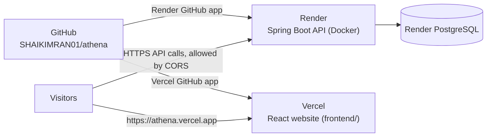

# Step 3 of 3: from GitHub to a live website on Vercel, safely

Before you start:
- [ ] [Step 1](STEP_1_VERCEL_PREREQUISITES.md) is done: accounts, secrets and names are ready.
- [ ] [Step 2](STEP_2_PUSH_TO_GITHUB.md) is done: the code is on GitHub and the **CI run is green**.

## The plan



* **Vercel** builds `frontend/` and serves the website from its global
  network, with HTTPS and the security headers in
  [`frontend/vercel.json`](../frontend/vercel.json).
* **Render** builds the API from the [`Dockerfile`](../Dockerfile) and creates
  the database, as described in [`render.yaml`](../render.yaml).
* **The browser calls the API directly.** The website learns the API's address
  from `VITE_API_BASE_URL`. The API accepts browser calls only from the
  website's address, listed in `CORS_ALLOWED_ORIGINS`.

### Why the API does not go on Vercel

Vercel's official function runtimes are Node.js, Bun, Python, Rust, Go, Ruby,
Wasm, Edge and Container. Java is not among them. The **Container** runtime
can run a Docker image, but it is **in Beta**, and it does not suit
Athena's API:

* Idle instances are shut down after 5 minutes, so the Java server keeps
  restarting.
* Each instance has its own memory. Athena's rate-limit and failed-login
  counters would split between instances, weakening those protections.
* Each instance opens its own database connections.

Render keeps the API running as one server, exactly as it was tested.
Sources are at the end of this guide.

### What in the code makes the split work

| Piece | What it does |
| --- | --- |
| [`frontend/vercel.json`](../frontend/vercel.json) | Builds with Vite. Sends page routes (`/dashboard`, `/history`, …) to `index.html`, so refreshing works. Adds `X-Frame-Options: DENY`, `nosniff`, `Referrer-Policy`, `Permissions-Policy`, HSTS and `frame-ancestors 'none'`. |
| `VITE_API_BASE_URL` ([`baseUrl.js`](../frontend/src/api/baseUrl.js)) | The API address built into the website. `/api` is added if missing. A non-HTTPS address fails the build. |
| CSP meta tag ([`csp.js`](../frontend/src/lib/csp.js)) | Written into `index.html` at build time: only the site's own scripts, and network calls only to itself and the API. |
| `CORS_ALLOWED_ORIGINS` ([`SecurityConfig.java`](../backend/athena/src/main/java/com/athena/security/SecurityConfig.java)) | The API answers browser calls only from the listed website addresses. |
| [`security-check.mjs`](testing/security-check.mjs) `--site` | After deploying, checks the website's headers and page routes, and that the API accepts it. |

This split was tested on this computer, with the website and the API on
separate addresses:
* all 6 browser journeys passed;
* the security check passed 23 out of 23;
* there were no CORS or security-policy errors.

On every backend test run,
[`CorsIntegrationTest`](../backend/athena/src/test/java/com/athena/security/CorsIntegrationTest.java)
also checks that the website and its preview addresses are allowed and that
other websites are refused.

---

## 3A. Connect GitHub to Render and put the API online

1. Go to https://dashboard.render.com and choose **New → Blueprint**.
2. **Connect GitHub.** Render asks to install its GitHub app. Choose **Only
   select repositories → athena**, not "All repositories". It then needs
   access to nothing else.
3. Pick the **athena** repository. Render reads `render.yaml` and lists
   `athena-db` (PostgreSQL), `athena-redis` (Key Value, for the shared rate
   limits) and `athena` (web service). Both stores accept connections only
   from Render's private network.
4. Fill in the values Render asks for. They are the `sync: false` entries in
   `render.yaml`:

   | Key | Value |
   | --- | --- |
   | `JWT_SECRET` | the key from Step 1, section 6 |
   | `DEMO_ADMIN_PASSWORD`, `DEMO_AUDITOR_PASSWORD`, `DEMO_USER_PASSWORD` | Step 1, section 6 |
   | `BOOTSTRAP_ADMIN_EMAIL`, `BOOTSTRAP_ADMIN_PASSWORD` | your own first administrator (delete both after the first start, step 7), or leave both empty |
   | `CORS_ALLOWED_ORIGINS` | `https://<your-vercel-project>.vercel.app` if you already know it, otherwise leave it empty for now (section 3C) |

5. Choose **Apply** (on newer screens, **Deploy Blueprint**). Keep the
   database and the API in the same region, the Blueprint's default: they
   talk over Render's private network. The first deploy builds the Docker
   image, which takes about 10 to 15 minutes. Follow it under **Logs**.
6. Copy the service address shown at the top, for example
   `https://athena.onrender.com`, and test it:
   ```bat
   curl https://athena.onrender.com/api/health
   ```
   - [ ] It answers `{"status":"UP","database":"UP","redis":"UP"}`.
   - [ ] **Logs** show `the app connects as athena_app` and `counted in Redis`.
7. If you filled in `BOOTSTRAP_ADMIN_*`: sign in with them, then open the
   `athena` service → **Environment** and delete both. (Later starts would
   ignore them, because an administrator exists, but a password does not
   belong in settings.) Add other staff in the app: **Users → Add staff
   member**.

## 3B. Connect GitHub to Vercel and put the website online

1. Go to https://vercel.com/new (or **Add New… → Project**).
2. **Import Git Repository → Continue with GitHub.** When Vercel asks to
   install its GitHub app, choose **Only select repositories → athena**. If
   `athena` is missing later, use **Adjust GitHub App Permissions** on the
   same page.
3. Choose **Import** next to `athena`, then configure:

   | Field | Value |
   | --- | --- |
   | Project Name | `athena` (this sets the address) |
   | Framework Preset | Vite (detected) |
   | **Root Directory** | **`frontend`**: choose **Edit** and select it. This is essential: `package.json` and `vercel.json` live there. |
   | Build and Output Settings | Leave the defaults. `vercel.json` sets `npm ci`, `npm run build` and `dist`. |
   | Environment Variables | `VITE_API_BASE_URL` = your Render address from 3A, for example `https://athena.onrender.com`. Apply it to Production and Preview. |

4. Choose **Deploy**. It takes about a minute.
   - [ ] Note the production address, for example `https://athena.vercel.app`.

`VITE_API_BASE_URL` is built into the website. If you change it later, open
**Deployments**, then ⋯ next to the latest one, then **Redeploy**.

## 3C. Connect the website and the API

1. Render → the `athena` service → **Environment** → set
   `CORS_ALLOWED_ORIGINS` to the exact Vercel address, for example
   `https://athena.vercel.app`. Use `https`, with no path and no `/` at the end.
2. Optional, to let Vercel *preview* deployments call the API too, add your
   team's preview pattern after a comma:
   ```
   https://athena.vercel.app,https://athena-git-*-yourteam.vercel.app
   ```
3. **Save Changes** (if Render offers a choice, pick **Save and deploy**).
   Render restarts the API with the new setting.

---

## 3D. Handle security

Work through every row. Each closes a real way in.

| # | Area | What to do | Where |
| --- | --- | --- | --- |
| 1 | **Accounts** | Two-factor authentication on GitHub, Vercel and Render. With "Sign in with GitHub", your GitHub login protects all three. | Each site's account settings |
| 2 | **GitHub app access** | Vercel's and Render's GitHub apps see **only** `athena`. Check under GitHub → your picture → **Settings → Applications → Installed GitHub Apps**. | GitHub |
| 3 | **Where secrets live** | `JWT_SECRET`, the demo passwords and the database login exist **only** in Render's Environment settings. Never in git, never in Vercel, never in chat or email. | Render |
| 4 | **Public by design** | Every `VITE_` variable ends up in the website's JavaScript, which anyone can read. Put **only** `VITE_API_BASE_URL` there, never a secret. | Vercel |
| 5 | **HTTPS everywhere** | `*.vercel.app` and `*.onrender.com` have HTTPS automatically. The website build refuses an `http://` API address, so tokens never travel unencrypted. HSTS tells browsers to stay on HTTPS. | Automatic |
| 6 | **CORS** | `CORS_ALLOWED_ORIGINS` lists only your exact website address. **Never** `https://*.vercel.app`: that would admit every website on Vercel. | Render |
| 7 | **Security headers** | Check them: `curl -I https://athena.vercel.app/dashboard` must show `X-Frame-Options: DENY` and `Content-Security-Policy: frame-ancestors 'none'`. The full policy is in the page's `<meta>` tag. | Your computer |
| 8 | **Preview deployments** | Project → **Settings → Deployment Protection**: make sure **Vercel Authentication** is on, with **Standard Protection**, so preview deployments need a Vercel login. The production address stays public for visitors and judges. | Vercel |
| 9 | **Pull requests from strangers** | Project → **Settings → Security**: keep **Git Fork Protection** on (the default). A pull request from someone else's fork then cannot deploy, or reach your environment variables, until you approve it. | Vercel |
| 10 | **Database** | `render.yaml` closes it to the internet (`ipAllowList: []`): only the API, over Render's private network, can connect. On the database's page, check that no inbound IP rule (such as `0.0.0.0/0`) is listed. Never copy its connection string anywhere. The free database is deleted after its expiry (Step 1). | Already done; check on Render |
| 11 | **Real client IPs** | `FORWARD_HEADERS_STRATEGY=native` is already set in the Docker image and in `render.yaml`, so rate limits and login throttling see each visitor's real IP behind Render's proxy. Do not change it. | Already done |
| 12 | **Demo accounts** | Long, unique passwords, shared with judges privately. After judging, change them on Render, or disable the demo users on the admin **Users** page. | Render, the app |
| 13 | **Watch for attacks** | Sign in as the auditor and open **Audit log**. Set **Action** to *Login locked* or *Access denied*, or **Outcome** to *Failed* (wrong passwords, refused money requests). **Overview** must say "The books balance". Render's **Logs** show each unexpected server error with an `errorId`, which is also in the error answer. | The app, Render |
| 14 | **Dependencies** | Dependabot opens pull requests for vulnerable libraries. Merge them only when the CI run is green. | GitHub |
| 15 | **Re-test after every deploy** | Run the security check with `--site` (section 3E). It should report `23 passed`. | Your computer |

### If a secret leaks

1. **`JWT_SECRET`**: set a new one on Render (Step 1, section 6). Every
   session ends and everyone signs in again.
2. **A demo password**: change it on Render, and check the audit log for
   sign-ins you don't recognise.
3. **The database owner's password**: in Render, open `athena-db` → **Info →
   Credentials** and add a new default credential. Open your Blueprint and
   choose **Manual Sync**, so the API's `DB_OWNER_USERNAME` and
   `DB_OWNER_PASSWORD` follow. When the API has restarted and `/api/health`
   answers `UP`, delete the old credential.
4. **The app role's password** (`DB_PASSWORD`): in the `athena` service's
   **Environment**, generate a new value and save. At the next start the app
   sets it on `athena_app` itself.
5. **A GitHub, Vercel or Render login**: change the password, sign out of all
   sessions, and review the installed GitHub apps (row 2).
6. **Committed to git by mistake**: removing it from the file is **not**
   enough, because it stays in the history. Change the secret first, as above.

---

## 3E. Check that everything works

1. **In a browser**, open `https://athena.vercel.app`:
   - [ ] register, sign in, deposit, withdraw, transfer, open History and Statement;
   - [ ] refresh on `/history`: the page still loads;
   - [ ] sign in as the demo admin (Users, Overview, Audit log) and the auditor (Overview, Audit log): Overview says "The books balance";
   - [ ] press F12 and open Console: there are **no** red CORS or Content-Security-Policy errors.
2. **The security check** against the live system:
   ```bat
   cd /d E:\athena
   set "AUDITOR_EMAIL=auditor@athena.demo"
   set "AUDITOR_PASSWORD=your-demo-auditor-password"
   node important\testing\security-check.mjs https://athena.onrender.com --site https://athena.vercel.app --report important\testing\SECURITY_CHECK_REPORT.md
   ```
   - [ ] `23 passed, 0 failed`.

   The quotes keep characters such as `&` in the password safe in CMD. The
   auditor sign-in lets the last check (L1) confirm that the ledger still
   balances after the attacks. Without it, L1 is skipped and you see `22 passed`.
3. **Postman.** Import `important\testing\Athena.postman_collection.json`,
   set the collection variable `baseUrl` to the Render address, and run it.
   Each run registers two new test users, who hold only test money.
   - [ ] 88 checks pass (folder 7 also changes the test user's password).
4. Put the Vercel address at the top of `README.md`, then commit and push it
   (Step 2, last section).

## 3F. Every feature, and what keeps it working

| Feature | Works because |
| --- | --- |
| Sign-up, sign-in, sign-out, automatic sign-out on expiry | Token in the browser, checked by the API on every call; CORS lets the website read 401 answers |
| Deposit, withdraw, transfer with confirmation | Direct HTTPS calls to the API; the `Idempotency-Key` header is allowed by CORS |
| Replays shown as "Already done" | The `Idempotent-Replayed` header is exposed by CORS |
| Rate limits and login throttling | Visitors connect to Render directly, so the API sees their real IP |
| History, details, statement, CSV, print | Page routes work after a refresh thanks to the `vercel.json` rewrite |
| Admin and auditor dashboards | Roles are checked by the API on every request |
| Security headers, clickjacking protection, strict CSP | `vercel.json` headers plus the CSP meta tag |
| Double-entry ledger, locking, audit log, integrity check | Unchanged: all in the API and PostgreSQL on Render |

## 3G. Day to day

* **Every push to `main`** redeploys the website (Vercel) and the API (Render).
* **Own domain:** Vercel → Settings → **Domains** → add it. Then add the new
  address to `CORS_ALLOWED_ORIGINS` on Render.
* **New JWT key:** change `JWT_SECRET` on Render. Everyone signs in again.

## 3H. If something goes wrong

| Symptom | Cause | Fix |
| --- | --- | --- |
| `athena` is missing when importing into Vercel or Render | The GitHub app was not given access to it | Use **Adjust GitHub App Permissions**, or GitHub → Settings → Applications → the app → add `athena` |
| Render cannot find a Blueprint file | `render.yaml` is not at the top level of `main` on GitHub | Finish Step 2; `render.yaml` must sit next to `README.md` |
| The API log says it cannot connect to the database | The database and the API are in different regions; the private network works within one region | Recreate the one in the wrong region, or deploy the Blueprint again with the default region for both |
| Console: "blocked by CORS policy" | `CORS_ALLOWED_ORIGINS` does not match the website address exactly | Copy the address from the browser bar: `https://`, no trailing `/`. Save; Render restarts. |
| Console: "Refused to connect … Content Security Policy" | The website was built without, or with an old, `VITE_API_BASE_URL` | Fix the variable in Vercel, then **Redeploy** |
| Vercel build fails: "VITE_API_BASE_URL must use https://" | The variable starts with `http://` | Use the `https://` Render address |
| Refreshing `/dashboard` gives 404 | Root Directory is not `frontend`, so `vercel.json` was not used | Settings → General → Root Directory = `frontend`, then redeploy |
| The first request after a pause times out | Render's free plan was asleep | Retry after a minute (money requests are safe to retry), or use an always-on plan |
| "Too many failed sign-in attempts" | Login throttling: 5 failures per email and network in 15 minutes | Wait 15 minutes |
| The API stops at startup: "JWT_SECRET is not set" or "must decode to at least 32 bytes" | Missing or short key | Set a key generated as in Step 1, section 6 |
| The API stops at startup: "Could not prepare the app's database role" | The owner settings are wrong, or the owner may not create roles | Check `DB_OWNER_USERNAME` and `DB_OWNER_PASSWORD` (Blueprint **Manual Sync** refills them). The message says how to run without a restricted role if you must |
| The API stops at startup: "The first administrator was not created: …" | `BOOTSTRAP_ADMIN_*` is half-filled or too weak, and no administrator exists yet | Fix or delete both values; the message names the setting |
| `/api/health` shows `"redis":"DOWN"` | The Key Value instance is missing, in another region, or restarting | Limits still work per instance meanwhile. Check `athena-redis` is running in the API's region and `REDIS_URL` is set |
| The Render build fails | Read the build log. A download error is usually temporary. | Render → **Manual Deploy → Deploy latest commit**. The same Docker build runs in GitHub's CI (the Docker image job): compare with it. |

## 3I. Alternative: everything on Vercel (not recommended yet)

Vercel's Container runtime could run the API from the `Dockerfile`, with a
PostgreSQL database from the Vercel Marketplace (for example Neon). Choosing
it means:
* accepting a **Beta** runtime;
* accepting Java cold starts after 5 minutes without traffic;
* a Redis store reachable from Vercel for the shared limits (the app already supports one through `REDIS_URL`);
* capping database connections per instance;
* confirming that visitors' real IPs reach the API.

Until then, the Render setup above keeps every tested protection intact.

## Sources

* [Vercel Functions runtimes](https://vercel.com/docs/functions/runtimes)
* [Vercel Container runtime](https://vercel.com/docs/functions/runtimes/container)
* [Vercel Deployment Protection](https://vercel.com/docs/deployments/deployment-protection)
* [Vercel project security settings (Git Fork Protection)](https://vercel.com/docs/project-configuration/security-settings)
* [Render Blueprint YAML reference (`ipAllowList`)](https://render.com/docs/blueprint-spec)
* [Render Postgres credential rotation](https://render.com/docs/postgresql-credentials)
* [Render free instances](https://docs.render.com/free)
